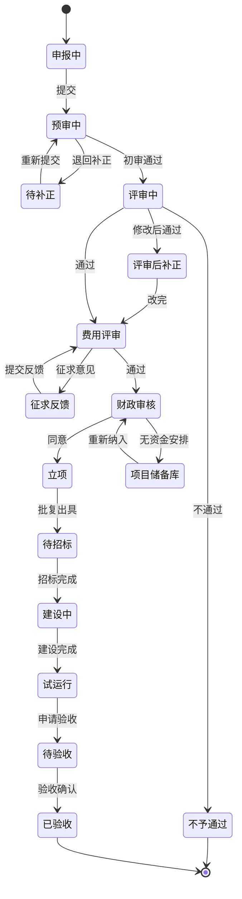

# 信息化项目全生命周期管理平台

面向市级数字化项目主管部门的业务系统。把信息化项目从**申报、预审、评审、费用评审、财政审核、立项、招标、建设、试运行到验收归档**的整条链路装进一个系统，让每个环节的办理人、办理依据、产出文书、时限与留痕都由系统承担，而不是散在邮件、共享盘和 Excel 台账里。

> 状态：v0.13，功能完整，生产可用。后端 209 项自动化测试全部通过。

---

## 目录

- [解决什么问题](#解决什么问题)
- [功能概览](#功能概览)
- [业务流程](#业务流程)
- [技术栈](#技术栈)
- [目录结构](#目录结构)
- [快速开始](#快速开始)
- [角色与权限](#角色与权限)
- [配置说明](#配置说明)
- [数据与备份](#数据与备份)
- [文档索引](#文档索引)
- [许可](#许可)

---

## 解决什么问题

信息化项目审批有三个反复出现的问题，这个系统是对它们的直接回应。

**一是状态不可知。** 一个项目报到哪一步、卡在谁手上、还剩几天，过去只能问经办人。系统用状态机承载流程：阶段不可手工改写，只能通过动作推进，每一步的责任角色、前置条件、产出物都在代码里写死。

**二是口径不统一。** 同一个申报单位写成三种名称，年度统计就按三个单位出数。系统把申报单位名录作为唯一取值域，下拉选择，材料解析出的非标准写法自动归一。

**三是重复建设看不见。** 新报上来的可研与历史档案是否有功能重叠，过去靠人翻。系统在提交申报与规则预审时自动比对历史档案，逐项列出对得上的功能、最相似的章节与原文片段。

---

## 功能概览

### 申报与材料

- 申报单位从名录下拉选择，九类分组（市委部门、市人大常委会、市政府部门、市政协常委会、市纪委监委、人民团体、直属机构、法检两院、垂直管理部门）
- 新建申报时可先上传可研报告或建设方案，系统抽取项目名称、申报单位、总投资、建设期、建设内容、必要性、政策依据、业务领域回填表单；抽不到的字段标注「写在模板第几节」
- 材料支持 PDF / DOCX / TXT / XLSX，按 SHA-256 去重
- 单份材料 200 MB 上限，按用户配额统计

### 预审

两级预审并行：

- **规则预审**：几百条勾稽规则，分 blocking / warning / info 三级
- **AI 语义审查**：走 OpenAI 兼容协议，可接商用云、政务云或本机 Ollama

两者结果合成一张可勾选清单，初审岗勾选出函，系统按勾选项生成《初审修改意见函》。

### 重复建设对照

- 功能级比对：从可研中抽取功能点，按动作词 + 对象词做相似度匹配
- 章节级比对：分节余弦相似度，给出最像的一章
- 段落级比对：原文左右两栏对照，标出基本一致的段落

### 评审与补正

- 按评审会实际走：上传签字意见扫描件、逐位录入专家结论（通过 / 修改后通过 / 不通过）
- 系统按「同意过半」自动生成结论，专家数须为 3 人以上单数
- 补正材料带轮次与版本，同名文件不混淆；「与上版对比」给段落级对照

### 费用评审

- 生成《费用评审任务书》交第三方财评机构，参数一次填、生成后锁定
- 第三方上传《费用评估报告》后可记通过
- 支持多轮：退回落到「征求反馈」环节，单位补材料或写无异议后直接回费用评审重评，不重走预审

### 财政审核、立项与后续

- 财政审核登记资金安排结论；不同意（无资金安排）的进项目储备库，有资金时由审核岗重新纳入
- 立项按模板生成批复，总投资以财评（财政）核定数为准
- 待招标确认招标完成；建设、试运行、验收依次推进
- 待验收时由主管部门出具《数据归集证明》——没有这份证明不能验收

### 档案与统计

- 历史档案导入、检索、按年度核对
- 阶段耗时、通过率、按单位与年度的统计
- 已验收项目可导出归档包（未验收的不给入口，避免导出半套材料）

### 系统管理

- 账号由管理员创建，不开放自助注册；支持停用、重置临时密码（对方下次登录强制修改）
- 环节审查时限按环节配置自然日，超期只提示不拦流程
- 账号角色可细分（角色 → 权限域映射），流程判断只认四个权限域
- 文书模板库：上传新版模板即替换内置模板
- 模型接入：预设、测试连接、密钥掩码显示、改完立即生效

---

## 业务流程



状态机在代码中的硬约束（`backend/apps/project/flow.py`）：

1. 阶段不能直接改，只能通过 `transition` 走动作
2. 规则预审没跑过，不能出「初审通过」
3. 规则预审有「必须补正」项，只能退回补正，不能带病上会
4. 评审会结论必须凭签字意见表或汇总表录入，一张都没传不能出结论
5. 票数合计须为单数，「通过 + 修改后通过」过半才算通过
6. 「修改后通过」先转单位改材料，改完直接交费用评审，不回预审
7. 费用评审必须先出任务书，立项必须先出批复；费用评审结论以第三方报告为准
8. 财政无资金安排的进储备库，不硬推招标，也不判死
9. 待招标只确认招标完成，不收中标通知书与合同
10. 待验收由主管部门出具《数据归集证明》，没有这份证明不能验收

---

## 技术栈

| 层 | 选型 | 说明 |
|---|---|---|
| 后端框架 | Django 5.2 + Django REST Framework 3.16 | 单体应用，四个 app 按领域切分 |
| 认证 | djangorestframework-simplejwt 5.5 | Access 2 小时、Refresh 7 天、刷新轮换 + 黑名单 |
| 数据库 | SQLite（默认）/ PostgreSQL | 通过 `PM_DB_ENGINE` 环境变量切换，无需改代码 |
| 文档解析 | pdfplumber、python-docx、openpyxl | PDF / DOCX / XLSX 文本与结构化提取 |
| 文书生成 | python-docx | 模板占位符替换，保留原模板版式 |
| 前端框架 | Vue 3.5 + Vite 6 | Composition API，按路由懒加载 |
| UI | Element Plus 2.9 | 政务蓝白主题 |
| 状态管理 | Pinia 3 | 登录态、用户信息 |
| HTTP | axios | 拦截器统一处理 401 与 token 刷新 |

不引入 Redis、Celery、消息队列：单机单进程即可运行，部署成本低。限流用 Django 默认 LocMemCache，多进程部署时需换 Redis 才能全局生效。

---

## 目录结构

```
.
├── backend/                 后端
│   ├── config/              项目配置（settings / urls / 分页 / 测试运行器）
│   ├── apps/
│   │   ├── core/            用户、角色、机构名录、JWT 版本化认证
│   │   ├── project/         项目主域：模型、流程状态机、文书生成、预审、比对
│   │   ├── archive/         历史档案：导入、解析、查重比对
│   │   └── aicore/          LLM 接入（OpenAI 兼容协议）
│   ├── spa/                 前端构建产物（由 npm run build 生成）
│   └── requirements.txt
├── frontend/                前端
│   └── src/
│       ├── api/             接口封装
│       ├── components/      通用组件
│       ├── composables/     组合式函数
│       ├── router/          路由与角色守卫
│       ├── stores/          Pinia
│       ├── styles/          全局样式
│       ├── utils/           工具函数
│       └── views/           页面
├── docs/                    技术文档（见下方索引）
├── data/                    运行时数据：数据库、日志、密钥（不进版本库）
├── media/                   上传原件与生成文书（不进版本库）
├── config.example.json      配置模板
└── 启动.command             macOS 一键启动（建环境、构建前端、迁移、起服务）
```

`data/` 与 `media/` 已在 `.gitignore` 中排除。**只拷数据库等于只剩目录**，材料原件都在 `media/` 里，备份必须两个目录一起拿。

---

## 快速开始

### 前置条件

- Python 3.11+
- Node.js 18+
- macOS / Linux（Windows 需要把 `启动.command` 的脚本改成 `.bat` 或手动执行下列命令）

### 方式一：一键启动（macOS）

```bash
./启动.command
```

脚本会依次完成：建虚拟环境 → 装依赖 → 判断前端是否需要重建 → 装前端依赖并构建 → 数据库迁移 → 起服务 → 打开浏览器。关闭终端窗口即停止服务。

### 方式二：手动启动

```bash
# 后端
cd backend
python3 -m venv .venv
./.venv/bin/pip install -r requirements.txt
./.venv/bin/python manage.py migrate
./.venv/bin/python manage.py init_accounts    # 建 4 个演示账号
./.venv/bin/python manage.py load_org_units   # 导入示例机构名录
./.venv/bin/python manage.py runserver 127.0.0.1:8000

# 前端（另开终端，开发模式带热更新）
cd frontend
npm install
npm run dev          # 访问 http://127.0.0.1:5173，代理到 8000
```

生产模式只需构建一次，后端直接托管产物：

```bash
cd frontend && npm run build    # 产物输出到 backend/spa/
cd ../backend && ./.venv/bin/python manage.py runserver 127.0.0.1:8000
```

### 首次登录

`init_accounts` 会创建四个演示账号（`admin` / `shenbao` / `chushen` / `shenhe`），初始密码在命令输出中打印。**所有账号首次登录强制修改密码**，包括管理员——初始口令写在源码里，等于公开的秘密。

正式部署请勿使用演示账号，改为用管理员账号在系统内逐个创建。

---

## 角色与权限

四个权限域，流程判断只认这四类；角色表可在此基础上细分（例如「初审岗（政务）」与「初审岗（产业）」都映射到 `reviewer`）。

| 权限域 | 默认职责 | 典型动作 |
|---|---|---|
| `applicant` 申报单位 | 填报与补正 | 新建申报、上传材料、提交、补正、申请验收 |
| `reviewer` 初审岗 | 预审、办会、出批复 | 规则预审、生成初审函、录入评审结论、出立项批复 |
| `auditor` 审核岗 | 费用评审、财政审核、验收 | 生成任务书、上传评估报告、登记财政结论、出具归集证明 |
| `admin` 管理员 | 系统管理 | 账号、角色、名录、时限、模板、模型接入、历史档案 |

权限在三个层面同时生效：

1. **接口层**：每个 ViewSet 声明所需权限域，越权返回 403
2. **动作层**：`flow.available_actions` 按当前阶段 + 当前用户角色下发可用动作，前端据此渲染按钮
3. **数据层**：申报单位只能看自己的项目；历史档案只对管理员开放

`is_staff` / `is_superuser` 每次保存都按当前角色同步。管理员被改成申报单位后不会残留 superuser 权限。

---

## 配置说明

复制 `config.example.json` 到项目外（推荐 `/etc/pm/config.json`），用 `PM_CONFIG` 环境变量指向：

```bash
export PM_CONFIG=/etc/pm/config.json
```

### 配置项

| 段 | 键 | 说明 |
|---|---|---|
| `llm` | `provider` / `base_url` / `model` / `api_key` | OpenAI 兼容接口。密钥可留空，改用 `PM_LLM_API_KEY` 环境变量注入 |
| `llm` | `enabled` | 默认 `false`。确认允许联网后再开 |
| `org` | `prefixes` | 单位名归一前要剥离的行政区前缀，如 `["XX市", "XX自治区"]` |
| `org` | `site` | 立项批复里的建设地点 |
| `org` | `issuer` | 数据归集证明等文书的出具单位 |
| `org` | `policy_name` | 文书正文引用的本地管理办法名称 |

`org` 段未配置时按中性占位值运行（`示例市` / `示例市数据管理局`），不影响功能。**部署到本地时应先配好这一段**，否则生成的批复与证明落款是占位文字。

### 环境变量

| 变量 | 默认 | 说明 |
|---|---|---|
| `PM_CONFIG` | `<项目根>/config.json` | 配置文件路径 |
| `PM_SECRET_KEY` | 自动生成 | 未设置时在 `data/.secret_key` 生成并 600 落盘 |
| `PM_DEBUG` | `0` | 置 `1` 开调试。**生产务必保持 0**，DEBUG 下 `/media/` 会被无鉴权托管 |
| `PM_ALLOWED_HOSTS` | `127.0.0.1,localhost` | 逗号分隔 |
| `PM_DB_ENGINE` | SQLite | 切 PostgreSQL 时填 `django.db.backends.postgresql` |
| `PM_LLM_API_KEY` | 空 | 优先于配置文件里的明文密钥 |
| `PM_LOCAL_OPEN` | 空 | 置 `1` 启用「在本机打开原件」，仅桌面模式用 |

---

## 数据与备份

| 内容 | 位置 |
|---|---|
| 数据库 | `data/db.sqlite3` |
| 上传材料 | `media/projects/<编号_项目名>/`，按 `01_申报材料/环节/`、`02_生成文书/`、`03_评审会材料/` 分块 |
| 档案附件 | `media/archive/<年月>/` |
| 结项归档包 | `data/exports/`（同项目留最近 3 份） |
| 运行日志 | `data/logs/pm.log`（按天轮转，保留 30 天） |
| 签名密钥 | `data/.secret_key`（首次启动自动生成，权限 600） |

**备份**：停服务后把 `data/` 与 `media/` 两个目录一起拷走。`data/.secret_key` 一并带走，否则恢复后所有已签发的 token 全部失效。

**换服务器**：拷两个目录 → 装依赖 → `migrate` → 起服务。数据库路径与媒体根目录都由 `settings.py` 按项目根推导，不需要改配置。

---

## 文档索引

| 文档 | 内容 |
|---|---|
| [docs/architecture.md](docs/architecture.md) | 系统架构：分层设计、模块职责、关键技术决策 |
| [docs/workflow.md](docs/workflow.md) | 业务流程与状态机：阶段、动作、前置条件、角色映射 |
| [docs/data-model.md](docs/data-model.md) | 数据模型：表结构、字段语义、关联关系 |
| [docs/api.md](docs/api.md) | API 接口：认证、项目、材料、文书、档案 |
| [docs/deployment.md](docs/deployment.md) | 部署指南：SQLite / PostgreSQL、gunicorn、Nginx、备份恢复 |
| [docs/security.md](docs/security.md) | 安全设计：认证、授权、上传校验、密钥管理 |
| [docs/development.md](docs/development.md) | 开发指南：环境搭建、调试、测试、构建 |
| [CONTRIBUTING.md](CONTRIBUTING.md) | 贡献指南 |
| [CHANGELOG.md](CHANGELOG.md) | 版本变更记录 |

---

## 许可

[MIT License](LICENSE)

代码可自由使用、修改、分发。系统内的机构名录为示例数据，实际部署请按本地机构编制口径替换（`backend/apps/core/org_data.py` 或 Django admin）。
