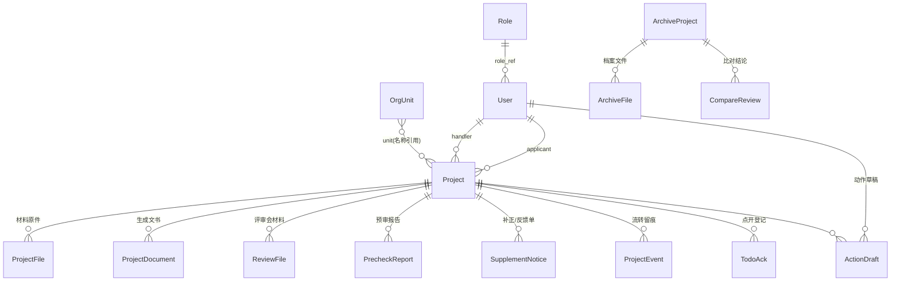

# 数据模型

四个 Django app 共 20 张业务表。本文按领域分组说明表职责、关键字段语义与关联关系。字段全部定义见各 app 的 `models.py`。

---

## 一、关系总览

---

## 二、身份与基础数据（core）

### Role

可细分的角色，映射到一个权限域。

| 字段 | 说明 |
|---|---|
| `code` | 唯一标识，如 `reviewer_zw` |
| `name` | 显示名，如「初审岗（政务）」 |
| `scope` | 权限域：`applicant` / `reviewer` / `auditor` / `admin` |
| `builtin` | 内置角色不可删除 |

**为什么角色与权限域分开**：流程判断只认四个域，机构细分岗位时只加角色、不改流程代码。

### User

继承 `AbstractUser`，`USERNAME_FIELD` 仍为 username。

| 字段 | 说明 |
|---|---|
| `role_ref` | 指向 Role，`PROTECT` 删除保护 |
| `role` | **只读属性**，返回 `role_ref.scope`；流程代码读这个 |
| `role_label` | 只读属性，返回 `role_ref.name` |
| `unit` | 单位名，取值来自 OrgUnit 名录 |
| `phone` | 手机，11 位校验 |
| `must_change_password` | 首次登录强制改密 |
| `token_version` | 口令版本。改密时 +1，token 内带 `tv`，认证时比对不等即视为吊销 |

`save()` 每次按当前角色域同步 `is_staff` 与 `is_superuser`。这是修漏洞后加的强制约束：管理员被降级后不该还能进 `/admin/`。

### OrgUnit

申报单位名录，申报表单与账号单位字段的唯一取值域。

| 字段 | 说明 |
|---|---|
| `name` | 标准名，唯一 |
| `group` | 一级分组：`party` / `npc` / `gov` / `cppcc` / `discipline` / `mass` / `direct` / `judicial` / `vertical` |
| `subgroup` | 二级分组，仅直属机构用（市委直属 / 政府直属） |
| `order` | 展示排序 |
| `aliases` | 别名列表，JSON |
| `active` | 停用后不在下拉出现，但历史数据的引用不断 |

种子数据在 `apps/core/org_data.py`，通过迁移 `0005_seed_org_units` 铺入，后续用 `load_org_units` 命令或 admin 维护。

---

## 三、项目主域（project）

### Project

一个申报项目。字段分六组。

**基本信息**

| 字段 | 说明 |
|---|---|
| `code` | 项目编号，唯一。按年度流水生成（`ProjectCodeSequence`） |
| `name` | 项目名称，200 字 |
| `applicant` | 申报账号，`PROTECT` |
| `unit` | 申报单位名（冗余存名称而非外键：名录调整不能改动历史项目） |
| `contact_name` / `contact_phone` | 联系人。每件单独填——同单位不同项目常是不同经办人 |
| `year` / `category` | 申报年度、业务领域 |
| `investment` | 总投资（可研申报口径） |
| `budget_amount` | **核定预算**。财评核减后写入，财政审核可再调；批复一律取这个数，没有才回落 `investment` |
| `duration_months` | 建设周期（月） |
| `summary` / `necessity` / `basis` | 建设内容、必要性、政策依据 |
| `sensitive` | 涉敏标记。勾选后材料不出网，只跑规则预审 |

**流转状态**

| 字段 | 说明 |
|---|---|
| `stage` | 当前阶段，16 个枚举值之一 |
| `handler` | 当前承办人。`handler_role` 说「哪个岗位办」，`handler` 说「谁办」。为空表示该岗位所有人都能接 |
| `handler_role` | 当前办理角色 |
| `round` | 补正轮次，每次退回 +1 |
| `submitted_at` / `stage_at` | 首次提交时间 / 进入当前阶段时间 |

**评审结论**

| 字段 | 说明 |
|---|---|
| `review_result` | 通过 / 修改后通过 / 不通过 |
| `review_agree` / `review_modified` / `review_reject` | 三档票数。**结论由票数算出，不手输** |
| `review_note` / `concluded_at` | 评审意见、结论时间 |
| `review_scan` / `review_scan_name` | 签字意见扫描件（整场一份），结论的原始凭证 |

**费用评审与财政审核**

| 字段 | 说明 |
|---|---|
| `audit_result` / `audit_note` / `audited_at` | 费用评审结论、意见、时间 |
| `fiscal_result` / `fiscal_note` / `fiscal_at` | 财政审核结论、意见、时间 |

费用评审审的是「合不合理」，财政审核审的是「有没有钱、给多少」。两件事分开留痕。

**立项**

| 字段 | 说明 |
|---|---|
| `approval_no` / `approval_note` / `approval_at` | 批复文号、说明、时间 |

**试运行与验收**

| 字段 | 说明 |
|---|---|
| `trial_summary` | 试运行情况（申报单位填） |
| `data_collect_scope` | 数据归集情况（申报单位填）——这两段是《数据归集证明》的正文来源 |
| `acceptance_applied_at` | 申请验收时间 |

**辅助**

| 字段 | 说明 |
|---|---|
| `dup_check` | 重复建设筛查结果快照，JSON |

### ProjectFile

上传的材料原件。

| 字段 | 说明 |
|---|---|
| `project` / `stage` / `round` | 归属项目、所在环节、补正轮次 |
| `doc_type` | 材料类型：可研、建设方案、投资概算、异议证据、费用评估报告（`cost_report`）等 |
| `file` / `name` / `size` | 文件与元信息 |
| `sha256` | 去重指纹 |
| `status` | 解析状态 |
| `parsed` | 解析结果（章节、要素），JSON |

`cost_report`（第三方评估报告）有三条特殊规则：不进查重池、不回填项目字段、解析门槛 0 字（多为盖章扫描件）。上传权限只对审核岗与管理员开放，类型由后端定死——防止借着传报告换掉申报正本。

### ProjectDocument

系统生成的对内对外文书。

| 字段 | 说明 |
|---|---|
| `kind` | `precheck_notice` / `cost_review_task` / `approval_reply` / `data_collect` |
| `stage` / `round` | 生成时所在环节与轮次 |
| `template` | 所用模板（内置或管理员上传的版本） |
| `meta` | 生成参数快照。任务书表单按它回填，参数没变就不该重复生成 |
| `created_by` | 生成人 |

### ReviewFile

评审会材料：签字意见表、汇总表、专家意见扫描件。

| 字段 | 说明 |
|---|---|
| `kind` | 意见表 / 汇总表 / 其他 |
| `round` | 轮次 |

**存在意义**：评审结论必须凭这里的文件录入。一张都没有时 `conclude` 动作不下发。

### PrecheckReport

预审报告，两级共用一张表。

| 字段 | 说明 |
|---|---|
| `level` | `rule` 规则预审 / `ai` AI 审查 |
| `round` | 轮次 |
| `verdict` | pass / block / warn |
| `items` | 问题项列表，JSON（含等级、条目、依据） |

### SupplementNotice

补正单与征求反馈单。

| 字段 | 说明 |
|---|---|
| `kind` | `supplement` 补正 / `feedback` 征求反馈 |
| `status` | 待办 / 已提交 |
| `round` | 轮次 |
| `items` | 要求补正或反馈的事项 |

费用评审的「征求反馈」与预审的「退回补正」用同一张表、不同类型：两者都是「要单位做点事再回来」，但回来之后的路径完全不同。

### ProjectEvent

流转留痕，每次动作一条。

| 字段 | 说明 |
|---|---|
| `action` | 动作键 |
| `from_stage` / `to_stage` | 前后阶段 |
| `role` / `user` | 以何角色、由谁执行 |
| `comment` | 经办意见 |
| `payload` | 当次提交的字段快照，JSON |
| `created` | 精确到秒 |

**时间精度**：`created` 在序列化器里单独声明为 `iso-8601`。全局 `DATETIME_FORMAT` 只到分钟，同一环节「出任务书」与「交报告」会分不出先后。**不可改全局**——`Archive.vue` 等处直接显示该字段，会露出 ISO 串。

### ActionDraft

动作表单草稿。填到一半的表单要能留在库里，否则切页面就丢。

| 字段 | 说明 |
|---|---|
| `project` / `action` / `user` | 归属 |
| `data` | 已填内容，JSON |

### ProjectCodeSequence

项目编号流水。按年度维护当前序号，编号格式 `XM{年}-{三位序号}`。

### DocTemplate

文书模板库。

| 字段 | 说明 |
|---|---|
| `kind` | 对应四份文书 |
| `file` / `name` | 模板文件 |
| `active` | 同一 kind 只有一份生效 |
| `uploaded_by` / `created` | 上传人与时间 |

没上传时用后端打包的模板（`apps/project/docs/templates/`）。

### TodoAck

「点开过」登记。用于在办箱判定。

| 字段 | 说明 |
|---|---|
| `project` / `user` | 谁点开了哪件 |
| `created` | 时间 |

申报中的单不记（`todo-ack` 对 `draft` 直接返回不写）。

### StageSla

环节审查时限。

| 字段 | 说明 |
|---|---|
| `stage` | 环节（唯一） |
| `days` | 自然日 |
| `role` | 可选，覆盖 `flow.STAGE_ROLE` 的默认岗位。配了就从别人的待办剔除该环节 |

超期只提示不拦流程。

---

## 四、历史档案（archive）

### ArchiveProject

档案级的项目条目，来源是导入的历史项目资料。

| 字段 | 说明 |
|---|---|
| `name` / `unit` / `year` | 名称、单位、年度 |
| `year_source` | 年度来源：`import` 手填 / `cover` 封面日期 / `filename` 文件名 / `content` 正文高频 |
| `year_confirmed` | 是否人工确认过。已确认的年度不被「年度核对」批量覆盖 |

年度识别优先级：导入手填 > 封面申报日期 > 文件名年份 > 正文高频年份。识别口径偏了可在档案页点「年度核对」逐条确认。

### ArchiveFile

档案文件。

| 字段 | 说明 |
|---|---|
| `project` | 归属档案项目 |
| `doc_type` | 可研 / 批复 / 验收材料等 |
| `file` / `sha256` | 文件与去重指纹 |
| `parsed` | 解析出的章节与要素，JSON |
| `status` | 解析状态 |

### CompareReview

重复建设比对结论。

| 字段 | 说明 |
|---|---|
| `project` | 发起比对的申报项目 |
| `scope` | 比对范围 |
| `verdict` | 结论 |
| `result` | 详细结果，JSON：功能级命中、章节级相似度、段落级对照 |

---

## 五、设计约定

### 名称冗余优先于外键

`Project.unit` 存的是单位名称字符串，不是指向 `OrgUnit` 的外键。理由：机构改革时名录会改名、合并、撤销，历史项目必须保持当时的写法，否则统计口径会随名录一起变。

同理 `ProjectEvent.role` 存角色码而非外键。

### 结论由数据算出，不手输

评审结论由三档票数计算，不由经办人选择。手输结论等于给了一个绕开票数的口子。

### 关键约束用 `PROTECT`

`Project.applicant`、`User.role_ref` 都是 `PROTECT`。删用户不能把项目一起删掉——项目是档案，用户是操作者，两者生命周期不同。

### 时间字段两套格式

全局 `DATETIME_FORMAT` 是 `%Y-%m-%d %H:%M`（界面显示用）。需要排序精度的地方在序列化器里单独声明 `iso-8601`。改全局格式会波及直接显示原值的页面。
