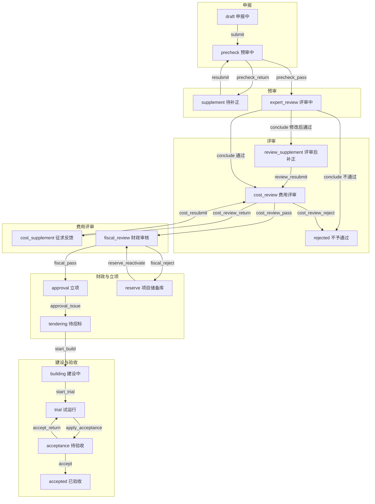

# 业务流程与状态机

系统的流程不是「一堆 if 判断」，而是一张显式登记的状态机。本文说明阶段划分、动作清单、前置条件与角色映射，供二次开发与业务核对使用。

唯一事实源：`backend/apps/project/flow.py`。

---

## 一、阶段一览

| 阶段键 | 显示名 | 默认办理角色 | 说明 |
|---|---|---|---|
| `draft` | 申报中 | 申报单位 | 草稿，未提交。**不进台账、不进任何人待办** |
| `precheck` | 预审中 | 初审岗 | 规则预审 + AI 审查，出初审意见 |
| `supplement` | 待补正 | 申报单位 | 按初审意见改材料 |
| `expert_review` | 评审中 | 初审岗 | 组织评审会、会后录入专家结论 |
| `review_supplement` | 评审后补正 | 申报单位 | 评审会给「修改后通过」时改材料 |
| `cost_review` | 费用评审 | 审核岗 | 交第三方财评机构，收评估报告 |
| `cost_supplement` | 征求反馈 | 申报单位 | 对评估意见反馈异议或补依据 |
| `fiscal_review` | 财政审核 | 审核岗 | 登记资金安排结论 |
| `approval` | 立项 | 初审岗 | 按模板出立项批复 |
| `tendering` | 待招标 | 初审岗 | 确认招标完成 |
| `building` | 建设中 | 初审岗 | 只记进度，不收过程档案 |
| `trial` | 试运行 | 申报单位 | 填报试运行情况与数据归集情况 |
| `acceptance` | 待验收 | 审核岗 | 出具《数据归集证明》，验收确认 |
| `accepted` | 已验收 | — | 终态，可导出归档包 |
| `reserve` | 项目储备库 | — | 非终态，有资金时重新纳入 |
| `rejected` | 不予通过 | — | 终态 |

---

## 二、流转路径

---

## 三、动作清单

| 动作键 | 显示名 | 允许角色 | 从 → 到 | 关键前置条件 |
|---|---|---|---|---|
| `submit` | 提交申报 | 申报单位 | draft → precheck | 必填字段齐全 |
| `withdraw` | 撤回修改 | 申报单位 | precheck → draft | **初审动手后不可撤回**（有预审报告或预审草稿即拦） |
| `rule_check` | 执行规则预审 | 初审岗 / 管理员 | precheck → precheck | — |
| `ai_review` | AI 深度审查 | 初审岗 / 管理员 | precheck → precheck | 模型已配置且启用 |
| `precheck_pass` | 初审通过，转评审 | 初审岗 / 管理员 | precheck → expert_review | 规则预审已跑；无 blocking 项 |
| `precheck_return` | 退回补正 | 初审岗 / 管理员 | precheck → supplement | 须填补正事项 |
| `resubmit` | 补正后重新提交 | 申报单位 | supplement → precheck | 补正材料已传 |
| `conclude` | 录入评审会意见 | 初审岗 / 管理员 | expert_review → 三选一 | 签字意见表或汇总表已传；票数为单数且过半 |
| `review_resubmit` | 改完提交费用评审 | 申报单位 | review_supplement → cost_review | 已改材料 |
| `cost_review_pass` | 费用评审通过 | 审核岗 / 管理员 | cost_review → fiscal_review | **第三方评估报告已上传** |
| `cost_review_return` | 征求反馈 | 审核岗 / 管理员 | cost_review → cost_supplement | 填反馈事项与期限 |
| `cost_resubmit` | 提交反馈 | 申报单位 | cost_supplement → cost_review | 可留空直接提交（记为「无异议，无需补充材料」） |
| `cost_review_reject` | 费用评审不通过 | 审核岗 / 管理员 | cost_review → rejected | — |
| `fiscal_pass` | 财政同意，转立项 | 审核岗 / 管理员 | fiscal_review → approval | 填审核意见 |
| `fiscal_reject` | 财政无资金，转储备库 | 审核岗 / 管理员 | fiscal_review → reserve | 填理由 |
| `approval_issue` | 批复已出具，转待招标 | 初审岗 / 管理员 | approval → tendering | **《立项批复》已生成** |
| `start_build` | 招标完成，转建设中 | 初审岗 / 管理员 | tendering → building | — |
| `start_trial` | 建设完成，转试运行 | 初审岗 / 管理员 | building → trial | — |
| `apply_acceptance` | 申请验收 | 申报单位 | trial → acceptance | 试运行情况、数据归集情况均须填 |
| `accept` | 验收确认，项目结项 | 审核岗 / 管理员 | acceptance → accepted | **《数据归集证明》已出具** |
| `accept_return` | 退回补充说明 | 审核岗 / 管理员 | acceptance → trial | 填退回理由 |
| `reserve_reactivate` | 重新纳入财政审核 | 审核岗 / 管理员 | reserve → fiscal_review | 填重新纳入理由（≥10 字） |

---

## 四、硬约束及其业务理由

这些约束写在代码里而不是提示语里。列表对应 `flow.py` 模块文档字符串的十一条。

### 1. 阶段只能过动作推进

`Project.stage` 没有任何一处被直接赋值。所有变化都走 `transition()`，必然产生一条 `ProjectEvent`。理由：状态与留痕不能失配，否则事后追责时说不清「这个件什么时候到这一步的」。

### 2. 规则预审没跑过，不能出「初审通过」

预审分规则与 AI 两级。规则预审是硬门槛——几百条规定动作，不跑就等于没审。

### 3. 规则预审有 blocking 项，只能退回补正

「必须补正」级问题存在时不允许上会。理由：带着硬伤上会，评委会否掉，白跑一趟；且评审会结论一旦是「不通过」，项目就终止了，没有补正机会。

### 4. 评审会结论必须凭签字材料录入

一张签字意见表或汇总表都没传，不能出结论。理由：结论要能落到纸面签字件上，纯系统录入无法应付审计。

### 5. 票数为单数，「通过 + 修改后通过」过半才算通过

避免 3 人中 2 人弃权时结论悬空。专家组要求 3 人以上单数，评审阶段可现场调整人数，不用退回补正。

### 6. 「修改后通过」走评审后补正，不回预审

改完直接交费用评审。理由：让同一批人把结论再表决一次没有意义，也浪费时间。这条路径与「待补正」是两条不同的路，不能共用。

### 7. 费用评审必须先出任务书，立项必须先出批复

这两份对外文书是环节交付物。没出文书就不能往下走——否则「办了但没东西给出去」。

费用评审的结论由第三方《费用评估报告》承担，没有报告不能记「通过」。审核岗不再填一段意见——那只能是抄一遍报告。

### 8. 财政无资金安排进储备库，不硬推招标也不判死

项目本身可能是好的，只是今年没钱。储备库不是终态，有资金时由审核岗「重新纳入财政审核」接着走。

### 9. 待招标只确认招标完成

不收中标通知书与合同——那是建设单位与招标代理之间的民事文件，收进来就是替别人保管责任。建设过程档案同样不收。

### 10. 试运行由建设单位执行

建设完成转试运行后，由申报单位填报试运行情况与「归集了哪些数据」，一并提出验收申请。这两段文字是《数据归集证明》的正文来源。

### 11. 待验收必须出具《数据归集证明》

证明按模板生成，不是让单位传扫描件。没有这份证明不能验收。专家验收意见在验收后收存备案，验收确认那一刻不以它为前提。

---

## 五、待办与在办箱的口径

系统把「待办」与「在办」分开，两者判定口径不同。

| 箱 | 口径 | 目的 |
|---|---|---|
| 待办 | 当前阶段的责任角色是你，且阶段不是 `draft` | 回答「今天该我动手的有几件」 |
| 在办箱 | 有草稿动作，或该件被你点开过（`TodoAck`） | 回答「我办到一半的件在哪」 |

两条重要规则：

1. **申报中的单不进在办箱**。`draft` 是「还没交出去的申报单」，不是「办到一半的审批件」。它从头到尾留在待办，侧栏角标一直计着。
2. **环节岗位可配**。`StageSla.role` 可覆盖 `flow.STAGE_ROLE` 的默认映射。配了岗位就要同步从别人的待办里剔除该环节，否则会出现「点进去没按钮」的件。留空表示沿用默认映射。

---

## 六、台账口径

台账（已办项目、统计、导出）**只列已经报出去的件**，默认排除 `draft`，任何角色都一样。

- 排查数据用 `include_draft=1`
- 前端不要再传 `exclude_draft`——漏传一处就会出现「刚建的单跑到已办项目里」
- 申报人的阶段下拉不列「申报中」，计数为 0 的阶段不列

---

## 七、撤回边界

`withdraw` 只到初审动手为止。判定条件：存在预审报告或预审草稿即不下发该动作。

门槛放在后端（`available_actions`），前端不置灰。理由：前端置灰可以被绕过，且新增入口时容易漏。

---

## 八、新增环节的步骤

1. `Project.Stage` 加枚举值
2. `flow.STAGE_ROLE` 加角色映射
3. `flow.ACTIONS` 加动作定义（`key` / `label` / `roles` / `stages` / `to` / `form` / `confirm`）
4. 生成并执行迁移
5. 若该环节有产出文书，在 `docgen.py` 加生成函数、`DocTemplate.Kind` 加枚举
6. 前端 `views/project-detail/` 下加该环节的办理卡
7. 补测试：至少覆盖「正确角色可推进」「错误角色 403」「前置条件不满足时拒绝」
